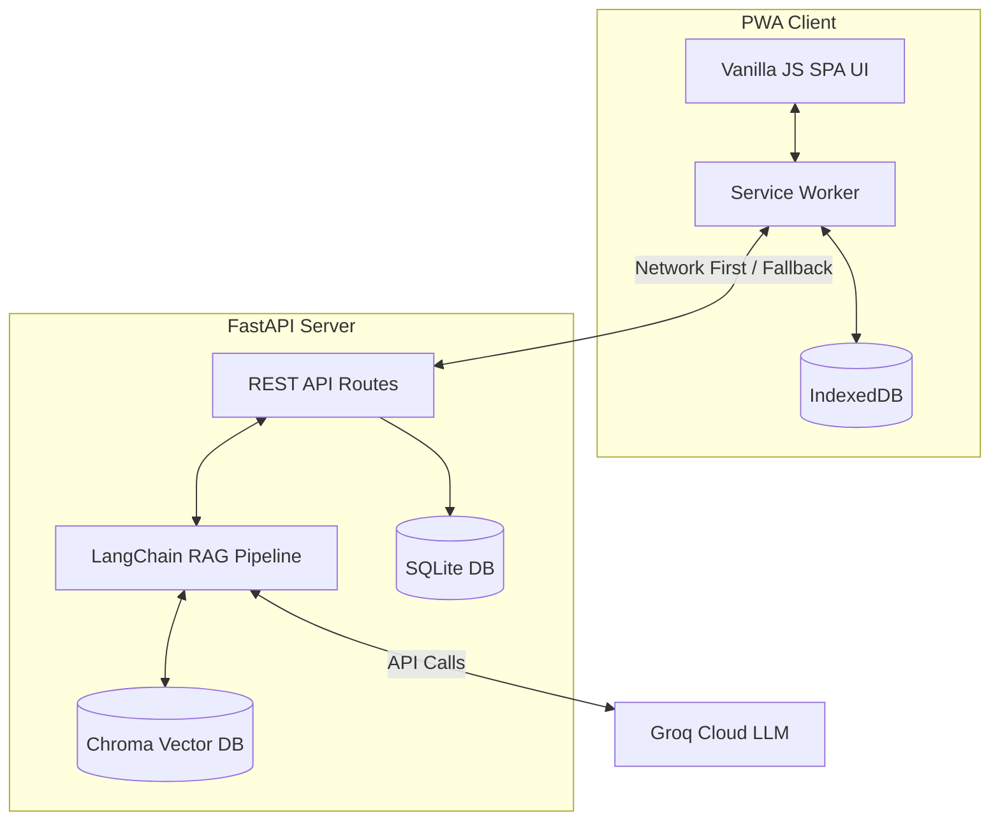

# DriveLegal — India's Road Traffic Law Assistant


**DriveLegal** is an intelligent, offline-first Progressive Web App (PWA) designed to empower Indian citizens with instant access to the Motor Vehicles Act (1988), state-specific amendments, and a precise Challan Calculator. Featuring an AI Legal Assistant powered by Retrieval-Augmented Generation (RAG), DriveLegal ensures you always know your rights on the road, even without an internet connection.

Built for the **Road Safety Hackathon 2026**.

---

## 🌟 Key Features

1. **Offline-First Architecture (PWA):** Syncs over 2,400+ traffic laws to IndexedDB, allowing users to browse laws and calculate fines in dead zones.
2. **AI Legal Assistant (RAG):** Ask complex legal questions in plain English. The AI cites specific sections of the MV Act, ensuring accuracy over hallucination.
3. **State-Specific Challan Calculator:** Accounts for regional fine multipliers, vehicle classes, repeat offences, and juvenile clauses instantly.
4. **Driver HUD & Analytics:** Real-time speed context and road safety indices tailored to the user's location.

---

## 🏗 Architecture

DriveLegal uses a modern API-first approach, decoupling the SPA frontend from a robust FastAPI backend.



---

## 🚀 Quick Start (Docker)

The easiest way to run the application is using Docker.

1. **Clone the repository:**
   ```bash
   git clone https://github.com/AdithyaSM31/DriveLegal---Road-Safety-Hackathon-2026.git
   cd DriveLegal
   ```

2. **Set your Groq API Key:**
   Create a `.env` file in the root directory and add your key:
   ```bash
   GROQ_API_KEY=gsk_your_api_key_here
   ```

3. **Run with Docker Compose:**
   ```bash
   docker-compose up --build
   ```

4. **Access the Application:**
   Open your browser and navigate to: `http://localhost:8000`

---

## 🛠 Manual Setup

If you prefer to run it natively:

1. **Install Python Dependencies:**
   ```bash
   pip install -r backend/requirements.txt
   ```

2. **Set Environment Variables:**
   ```bash
   export GROQ_API_KEY=gsk_your_api_key_here
   ```

3. **Seed the Database:**
   ```bash
   python scripts/seed_database.py
   ```

4. **Start the Server:**
   ```bash
   python backend/main.py
   ```
   *The server will run on `http://localhost:8000` and automatically serve the static frontend.*

---

## 📸 Screenshots

* **Dashboard & Driver HUD:** Real-time context and quick actions.
* **Challan Calculator:** Precise state-by-state fine calculation.
* **AI Assistant:** Context-aware legal chat with RAG.
* **Law Browser:** Lightning-fast offline law searching.

*(Note to Judges: Please refer to the Pitch Video included in our submission for a full walkthrough of the UI).*

---

## 👨‍💻 The Team

* **Adithya** — Lead & Backend Architect
* **Vaishnav** — Frontend & UI/UX Design
* **Rishi** — PWA & Offline Sync
* **Marion** — Database Engineering
* **Nitin** — AI & RAG Pipeline
* **Aysha** — Backend Analytics
