# DriveLegal v2 native previews

Captured from the built Kotlin app on an Android 16.1 emulator. These are running screens, not design mockups.

## Home

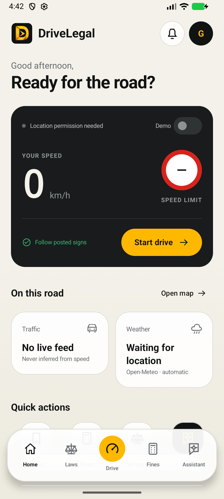

## Traffic laws

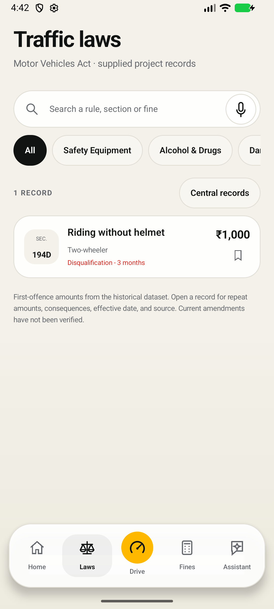

## Fine calculator

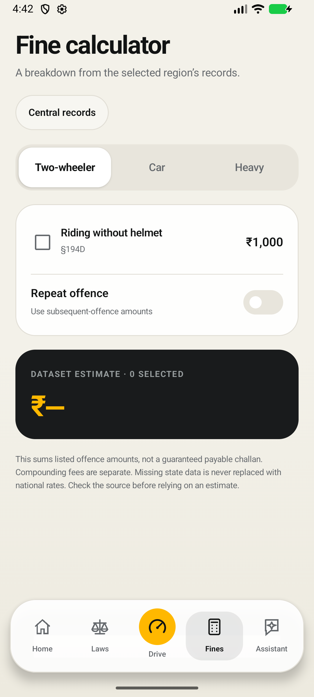

## Assistant

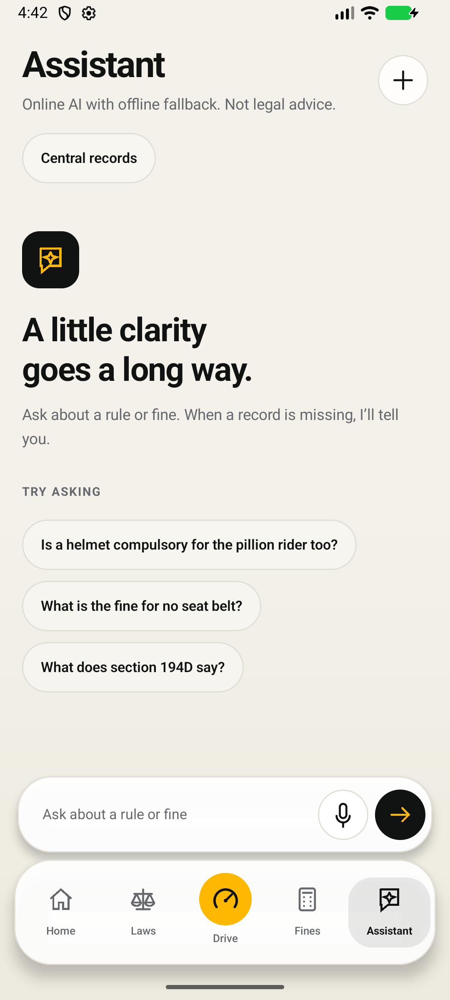

## Drive simulation

The speed and posted limit in this screenshot are explicit test inputs. The End drive control stays fixed at the bottom.

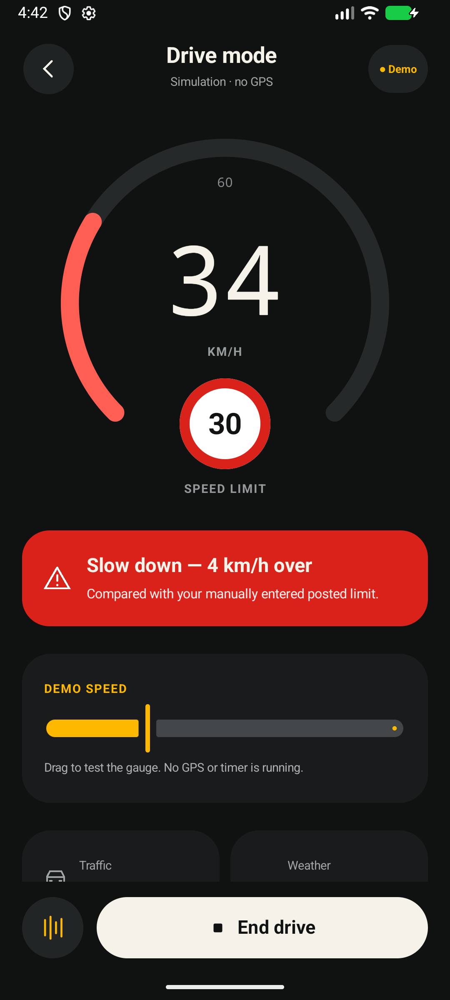

## Native PDF rendering

A multi-page report was generated inside Android and opened with Android's PDF renderer. This is its first page.

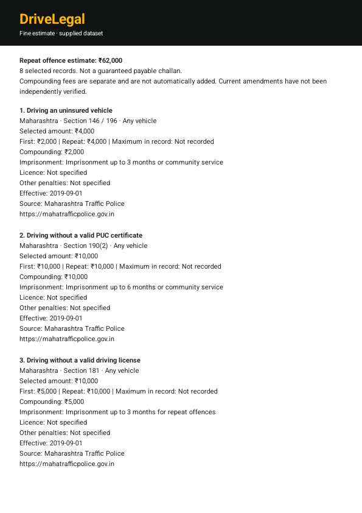

## Validation

- Kotlin debug and instrumentation APK builds passed.
- 13 native unit tests passed.
- 4 Android emulator instrumentation tests passed: five-screen navigation/Drive simulation; multi-page PDF generation/rendering; account UI plus persisted dark mode across the app; native logo rendering.
- 13 API regression tests and 7 web/offline data tests passed.
- Browser verification confirmed jurisdiction selection and repeat-offence calculation in the companion web app.
- Legal source currency, physical-device battery use, live GPS accuracy, microphone service behavior, production AI credentials, and release signing remain outside these automated checks.

## Firebase sign-in and app-wide dark mode

The native app uses the original Firebase project and package. Screens below show the actual account UI and saved dark-mode setting; no real Google credentials were selected during automated testing.

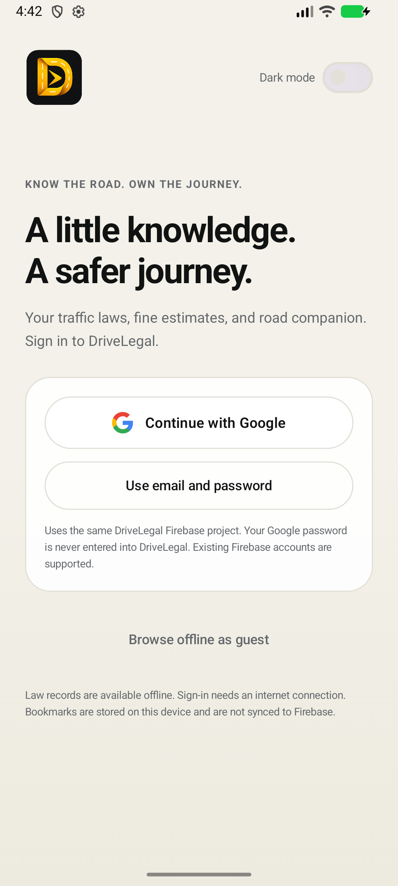

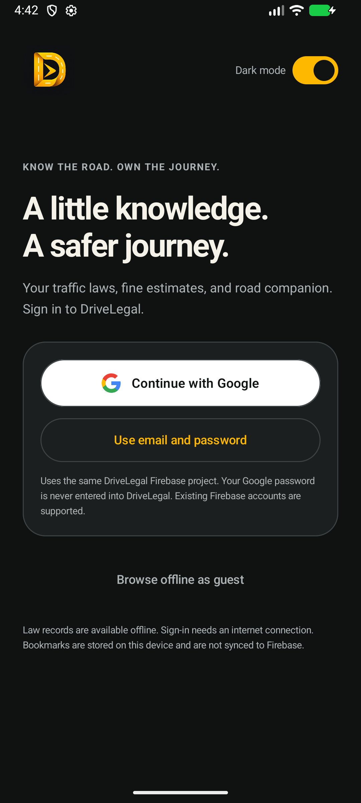

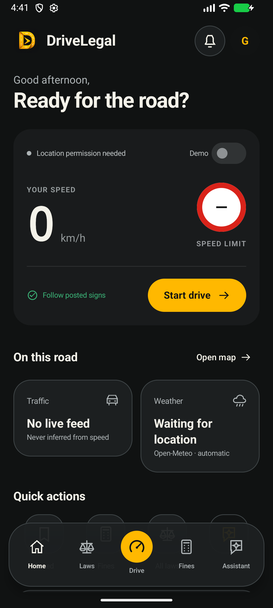

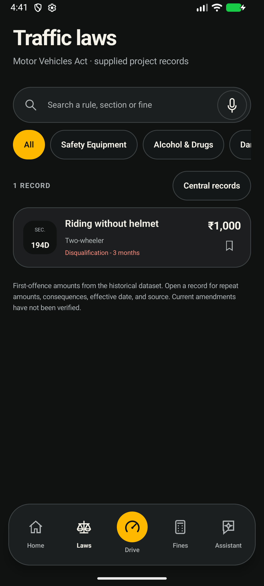

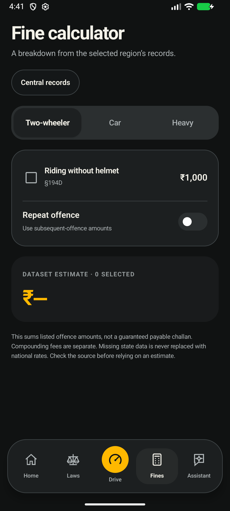

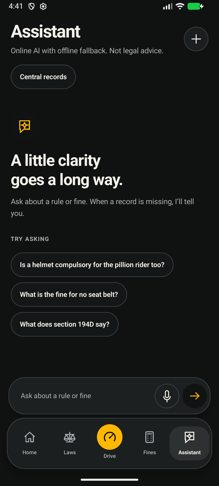

## New logo

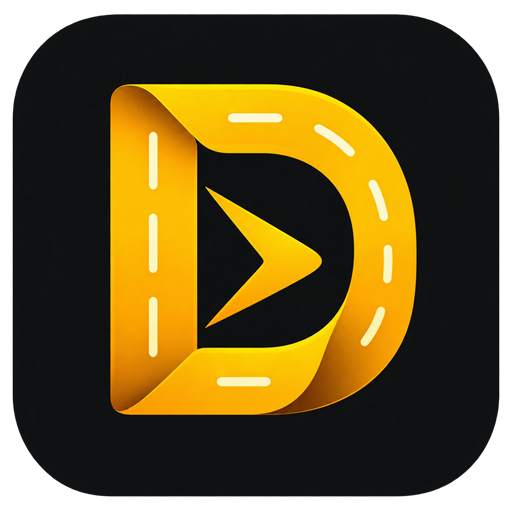

Google/Firebase integration was compiled and its account controls tested. A successful real-account Google login must still be checked on the user's device. The existing debug certificate matches the Android OAuth configuration. The Render service was independently checked and is reachable, but its deployed API remains the older version; see the native README for deployment compatibility details.

The Motion D logo revision (2.0.2) compiled successfully and passed two focused emulator checks covering raster/adaptive artwork and its light/dark screen placements. The Home and account screenshots above were refreshed from that build.
